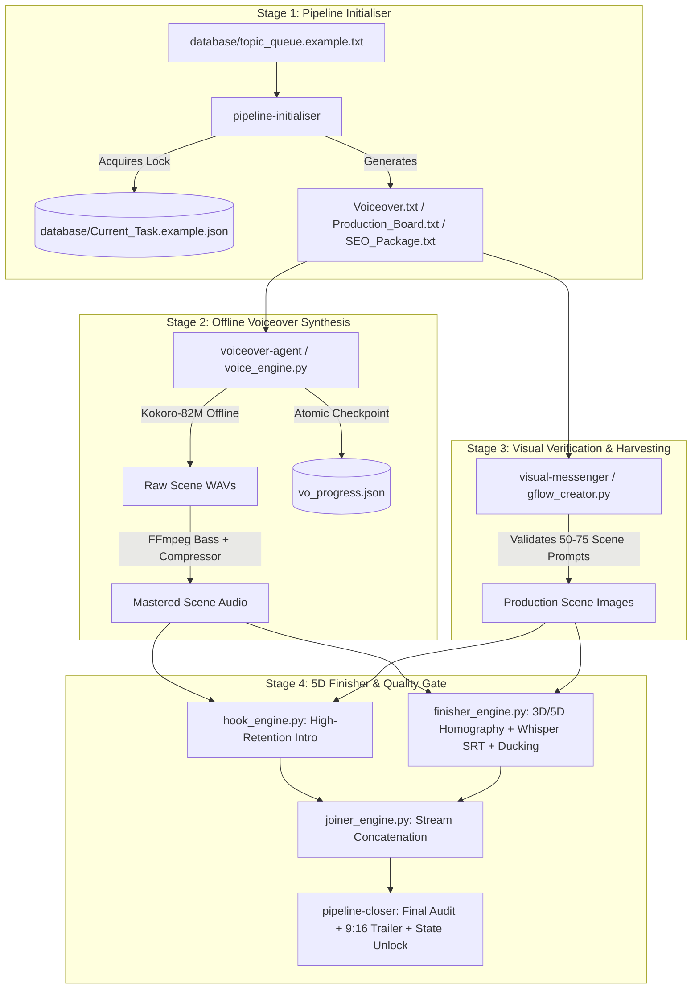

# Throne and Dust Autonomous Pipeline 🎬
**End-to-End Autonomous Documentary Rendering Engine with 3D/5D Perspective Homography, Offline Kokoro TTS, and Atomic State Resumption**

[](https://www.python.org/)
[](engines/render_5d_finisher/finisher_engine.py)
[](engines/voice_engine.py)
[](engines/render_5d_finisher/finisher_engine.py)

Architected by **Muhammed Nafiu** ([@VeetechnologiesNG](https://github.com/VeetechnologiesNG))  
Abuja, Nigeria | Autonomous Systems Architect & AI Copilot Engineer

> **Intellectual Property & Public Showcase Notice:** This repository is an architectural and systems-engineering showcase. Full system specifications, database schemas, JSON validation contracts, state-machine interfaces, and automated test suites are included in full. To protect commercial IP, proprietary prompt constitutions, live outreach copy, and internal rendering weights are maintained in private production builds.

---

## Executive Summary & Real Problem Solved

Producing broadcast-grade 10 to 15 minute historical documentaries traditionally requires 18+ hours of manual timeline keyframing, voiceover mastering, audio ducking, and subtitle synchronization per episode.

**Throne and Dust Autonomous Pipeline** replaces manual timeline editing with a deterministic, state-machine-driven rendering pipeline that compresses production turnaround from **18 hours to under 45 minutes of local compute**:

1. **3D/5D Multi-Axis Compound Camera Math (`finisher_engine.py`):** Eliminates static Ken Burns pans by computing per-frame 3D Perspective Homography Matrices (`cv2.warpPerspective`) across Pitch, Yaw, Roll, and Scale. Each 10 to 15 second scene executes a 2-phase dual choreography (Sub-Choreography A morphing seamlessly into Sub-Choreography B via continuous cosine blending).
2. **Offline Neural Voiceover & Broadcast Mastering (`voice_engine.py`):** Runs Kokoro-82M neural TTS 100% offline with local checkpoint caching (`vo_progress.json`) and passes raw audio through an automated FFmpeg broadcast mastering chain (`bass` boost + `acompressor`).
3. **Word-Level Whisper Subtitle Synchronization:** Extracts sub-millisecond word timestamps via OpenAI Whisper and compiles 4-word chunked `.srt` captions with 150ms fade-in/fade-out transitions (`{\fad(150,150)}`).
4. **Deterministic State Machine (`Current_Task.example.json`):** Coordinates 4 specialized autonomous stages with strict lock validation, anti-loop guardrails, and mid-batch crash recovery.

---

## System Architecture



---

## Core Engineering Pillars

### 1. 3D/5D Multi-Axis Compound Motion Framework (`finisher_engine.py`)
Instead of simple linear scaling, every scene is governed by a 2-phase compound homography matrix calculated via `cv2.warpPerspective` with OpenCL hardware acceleration enabled (`cv2.ocl.setUseOpenCL(True)`):

| Motion Tag | Sub-Choreography A (Phase 1) | Sub-Choreography B (Phase 2 Cosine Blend) |
| :--- | :--- | :--- |
| `REVEAL_PULL` | Archival Focal Spiral (Pull out + tightening spiral orbit + pitch drop) | Counter-rotation stabilize with subtle horizon level |
| `DRONE_DIAGONAL` | Clockwise diagonal sweep with cubic easing and pitch arc | High-altitude glide with yaw counter-drift |
| `DRONE_SINGLE` | Horizontal axis drift with pitch stabilization | Micro-zoom focal lock |
| `STATIC_BREATH` | Asymmetric inhale scale pulse (`breath_asymmetric`) + micro-roll | Exhale settle with focal drift |
| `Z_CRASH_FOCUS` | Exponential Z-axis punch-in (`ease_out_expo`) | Micro-oscillation shock absorption |
| `TILT_ASCEND` | Vertical crane tilt with sine-linear blend (`tilt_ascend_scale`) | Apex plateau stabilization |

* **Non-Linear Easing Library:** Implements `ease_out_quintic`, `ease_in_out_cubic`, `ease_out_expo`, `ease_in_out_sine`, and `ease_hesitate` (deliberate micro-hitch at 60% phase).
* **Anti-Repeat Solver (`assign_motion_tags`):** Guarantees no two consecutive scenes ever share the same motion signature.
* **Dynamic Zone Color Grading (`get_zone_grade`):** Shifts brightness, contrast, saturation, and RGB tint dynamically across the narrative arc of the documentary.

### 2. Offline Neural Voiceover & FFmpeg Broadcast Mastering (`voice_engine.py`)
* **Zero-Cloud Dependency:** Routes model weight lookups (`kokoro-v1_0.pth`, `bm_george.pt`, `am_michael.pt`, `am_fenrir.pt`) directly to the local `Kokoro_Offline_Core` directory.
* **Automated Mastering Chain:** Every synthesized scene is piped through FFmpeg for authoritative documentary vocal presence:
  ```text
  bass=g=5:f=110:w=0.6,acompressor=threshold=-15dB:ratio=4:attack=5:release=50:makeup=4
  ```

### 3. State Machine & Atomic Crash Recovery
* **`database/Current_Task.example.json`:** Enforces a single-project active lock. `pipeline-initialiser` refuses to overwrite an active project unless `status` is `"COMPLETED"` or `"IDLE"`.
* **Scene-Level Checkpointing (`vo_progress.json`):** `voiceover-agent` verifies physical MP3 existence and byte size (`> 1KB`) after every scene. If interrupted by power loss or process termination, re-running the engine resumes from the exact unrendered scene index.
* **Supreme Quality Gate (`pipeline-closer`):** Physically audits all N scene audio files, images, thumbnails, and trailer crops before resetting `Current_Task.json` to unlock the next topic in the queue.

---

## Repository Structure

```text
throne-and-dust-pipeline/
├── README.md                                  # Architecture & mathematical documentation
├── .env.example                               # Environment configuration template
├── .gitignore                                 # Excludes weights (>100MB), browser profiles, & raw media
│
├── database/                                  # State Machine & Queue Contracts
│   ├── Current_Task.example.json              # Active task lock contract
│   └── topic_queue.example.txt                # Example historical documentary queue format
│
├── workers/                                   # 4 Autonomous Stage Contract Specifications
│   ├── pipeline-initialiser/SKILL.md          # Stage 1: Queue ingestion & project scaffolding contract
│   ├── voiceover-agent/SKILL.md               # Stage 2: Offline TTS synthesis & crash recovery contract
│   ├── visual-messenger/SKILL.md              # Stage 3: Visual inspection & prompt batching contract
│   └── pipeline-closer/SKILL.md               # Stage 4: Final audit, thumbnails, & state unlock contract
│
└── engines/                                   # Typed Engine Interfaces & CLI Launchers
    ├── voice_engine.py                        # Offline Kokoro-82M neural TTS + FFmpeg mastering interface
    ├── Run_Voice_Engine.bat                   # CLI batch wrapper for voice synthesis
    │
    ├── render_5d_finisher/                    # Core Video Rendering Suite Interfaces
    │   ├── finisher_engine.py                 # 3D/5D homography, Whisper SRT, & audio ducking interface
    │   ├── hook_engine.py                     # 30 FPS kinetic intro hook renderer interface
    │   ├── joiner_engine.py                   # Lossless FFmpeg segment concatenator interface
    │   ├── Run_Full_Render_Suite.bat          # Master sequential render launcher
    │   ├── Run_Hook_Engine.bat
    │   ├── Run_Main_Engine.bat
    │   └── Run_Joiner_Engine.bat
    │
    └── visual_harvester/                      # Automated Visual Asset Harvester Interfaces
        ├── gflow_creator.py                   # Automated batch prompt dispatcher interface
        └── gflow_semi_manual.py               # Controlled 2K asset downloader interface
```

---

## Author
**Muhammed Nafiu**  
Founder & Autonomous Systems Architect at VeeTech Studio  
Abuja, Nigeria | [LinkedIn](https://www.linkedin.com/in/muhammed-nafiu) | [Portfolio](https://veetechstudio.com) | [Email](mailto:mnafiu35@gmail.com)
